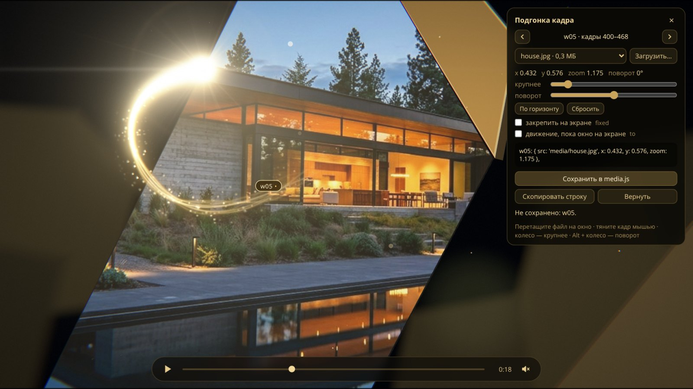

# circle.animaation.proto-2

Анимация на **three.js** по мотивам ролика `video.mp4` (1280×720, 24 к/с, 1213 кадров ≈ 50,5 с): камера летит между
золотыми гранёными осколками, на гранях — «окна» с видеокадрами, а через весь ролик, от первого кадра до финальной вспышки,
летит один свет со шлейфом. В финале из вспышки появляется эмблема — золотой циркуль, рисующий вокруг себя круг света, — и
подпись «Янтарный циркуль».

## Запуск

```bash
npm install
npm run dev       # http://localhost:5173
npm run build     # статическая сборка в dist/ (относительные пути, можно открыть с любого хостинга)
```

Управление: **Пробел** — пауза/воспроизведение, **← / →** — ±1 с (с **Shift** — ±1 кадр), **M** — звук, **B** — киношные
полосы 2,39:1, **E** — подгонка своих кадров в окнах (только в `npm run dev`, см. ниже).
Параметры адреса: `?f=<кадр>` или `?t=<секунды>` — начать с этого места, `?paused` — не запускать, `?dpr=1` — задать плотность
пикселей вручную (и отключить автоподбор качества), `?scope` — сразу с полосами 2,39:1, `?card` — разметка 16:9 в окнах
вместо картинок (см. ниже), `?nowarm` — пропустить прогрев (для покадровой съёмки).
В консоли доступен `window.__player` (`renderAt(f)`, `seek(t)`, `play()`, `pause()`, `setSound(on)`).

## Свои фото и видео в окнах

В ролике 11 «окон» — граней, на которых показана картинка. В любое из них можно поставить свою фотографию или видео.
Всё задаётся в одном файле, [`src/media.js`](src/media.js):

```js
export default {
  w03: { src: 'media/facade.jpg' },                                 // фото по центру окна
  w05: { src: 'media/house.jpg', x: 0.3, y: 0.4, zoom: 1.2 },       // левая часть кадра, чуть крупнее
  w08: { src: 'media/flight.mp4', start: 2, to: { zoom: 1.08 } },   // видео со 2-й секунды и медленный наезд
  w10: { src: 'media/tower.jpg', fixed: true },                     // кадр стоит на экране, окно пролетает над ним
};
```

Заполнять его можно мышью или руками — как удобнее. Окно без строки показывает прежний кадр-заглушку. Если файл не
найден или не открывается, тоже остаётся заглушка, а в консоли браузера появляется предупреждение. В сборку
(`npm run build`) файлы из `public/media/` попадают сами.

### Мышью: «Подгонка кадра»

Запустите `npm run dev`, откройте страницу и нажмите **E** — или кнопку с картинкой в панели управления, или добавьте
к адресу `?edit`. Справа появится панель, а на окнах — их номера.



- **Поставить файл.** Перетащите фото или видео с компьютера прямо на окно: файл попадёт в `public/media/`, а в
  `src/media.js` появится строка этого окна. То же делает кнопка «Загрузить…». Файлы, которые уже лежат в
  `public/media/`, выбираются из списка; «заглушка» в списке возвращает окну прежний кадр.
- **Подогнать.** Тяните кадр мышью внутри окна. Колесо — крупнее и мельче, вокруг точки под курсором; **Alt + колесо** —
  поворот. Ползунки в панели делают то же без колеса. «По горизонту» — это `rotate: 'level'`, «закрепить на экране» —
  `fixed`.
- **Движение.** Галочка «движение, пока окно на экране» включает `to`. Кнопкой «к началу» перейдите в начало окна и
  поставьте кадр так, как он должен стоять сначала, затем «к концу» — и так, как в конце.
- **Сохранить.** «Сохранить в media.js» записывает строки всех окон, где что-то сдвинуто; страница при этом не
  перезагружается. Готовая строка всегда показана в панели — её можно и просто скопировать.

Стрелки вверху панели переходят от окна к окну. Фото больше 4096 px по длинной стороне при загрузке уменьшается до
этого размера (больше ролик всё равно не показывает) и сохраняется как JPEG; остальные файлы кладутся как есть,
предел — 95 МБ.

Инструмент — часть dev-сервера, в сборку он не попадает. Записывать он может только с того компьютера, где запущен
сервер: если страница открыта с другого устройства или через прокси, кадр двигается и строка показывается, но
сохранить её можно лишь руками. Разрешить запись и оттуда — `MEDIA_TOOL=remote npm run dev`
(в PowerShell: `$env:MEDIA_TOOL='remote'; npm run dev`).

### Руками: файл `src/media.js`

1. Положите файлы в `public/media/`.
2. Добавьте строку с номером окна: `w01` … `w11`, по порядку появления в ролике (карта ниже).
3. Запустите `npm run dev`, поставьте ролик на паузу на этом окне и подбирайте числа. Положение кадра (`x`, `y`,
   `zoom`, `rotate`, `to`, `fixed`) меняется на экране сразу, как только файл сохранён; после остальных правок
   страница загружается заново и остаётся на том же кадре.


Сверху — окно с заглушкой, снизу — оно же с разметкой 16:9: видно, какую часть горизонтального кадра окно берёт без
настроек. Ту же разметку в самом ролике показывает адрес с `?card` — например, `http://localhost:5173/?card&f=415&paused`,
— причём уже с вашими `x`, `y`, `zoom` из `src/media.js`.

### Окна

| Окно | Кадры | Длится | Форма (ш : в) | От кадра 16:9 берёт | Доля экрана | Открыть для настройки | Заглушка |
| --- | --- | --- | --- | --- | --- | --- | --- |
| `w01` | 143–187 | 1,9 с | 0,86 | 48 % ширины | ≈ 35 % | `?f=172&paused` | рабочие |
| `w02` | 188–231 | 1,8 с | 1,74 | почти весь | ≈ 95 % | `?f=215&paused` | крупный план |
| `w03` | 240–307 | 2,8 с | 0,78 | 44 % ширины | ≈ 33 % | `?f=285&paused` | завод |
| `w04` | 335–387 | 2,2 с | весь экран | весь | 100 % | `?f=362&paused` | подстанция |
| `w05` | 400–468 | 2,9 с | 1,02 | 57 % ширины | ≈ 44 % | `?f=415&paused` | монтажник |
| `w06` | 486–521 | 1,5 с | 0,90 | 51 % ширины | ≈ 31 % | `?f=508&paused` | каска |
| `w07` | 522–532 | 0,5 с | 1,87 | почти весь | ≈ 73 % | `?f=528&paused` | поле с опорами |
| `w08` | 533–598 | 2,8 с | 1,23 | 69 % ширины | ≈ 58 %, с кадра 577 уходит за край | `?f=552&paused` | опоры |
| `w09` | 554–655 | 4,3 с | 1,47 | 83 % ширины | сначала ≈ 17 % у левого края, с кадра 577 ≈ 51 % | `?f=610&paused` | шкаф |
| `w10` | 678–738 | 2,5 с | 0,74 | 42 % ширины | ≈ 41 % | `?f=710&paused` | молодой человек |
| `w11` | 807–901 | 4,0 с | 0,75 | 42 % ширины | ≈ 60 % | `?f=870&paused` | ветрогенераторы |

«Форма» — отношение ширины к высоте той части окна, которая хоть раз попадает в экран: камера часто подлетает так близко,
что целиком окно не видно, и то, что остаётся за кадром, место в вашей картинке не занимает. Вертикальному окну
(форма меньше 1) лучше подходит вертикальный кадр — от горизонтального оно возьмёт только среднюю часть. Кадр `w04`
закреплён на экране (см. `fixed`), поэтому он виден целиком.

### Настройки

| Ключ | Что делает | Без него |
| --- | --- | --- |
| `src` | файл в `public/media/`: фото (jpg, png, webp, avif) или видео (mp4, webm) | — |
| `x`, `y` | какую часть кадра показать, от 0 до 1: `x: 0` — левый край, `1` — правый; `y: 0` — верх, `1` — низ | `0.5` — середина |
| `zoom` | увеличение, от 1: при `1` кадр ровно закрывает окно, больше — крупнее | `1` |
| `rotate` | поворот кадра по часовой стрелке, в градусах; `'level'` — выровнять кадр по горизонту экрана (окна `w06`–`w08` наклонены на 3–8°) | `0` |
| `to` | `{ x, y, zoom, rotate }` — к чему плавно прийти, пока окно на экране: медленный наезд, отъезд или панорама | кадр неподвижен в окне |
| `fixed` | `true` — кадр закреплён на экране и занимает его целиком, а окно — прорезь, через которую он виден; `false` — кадр «наклеен» на окно и летит вместе с ним | `false`, для `w04` — `true` |
| `start` | видео: с какой секунды начать | `0` |
| `rate` | видео: скорость (`0.5` — вдвое медленнее) | `1` |
| `loop` | видео: `false` — не повторять, остановиться на последнем кадре | повтор по кругу |
| `sharpen` | подчеркнуть резкость мягкого исходника, от 0 до 1 | `0` |

Кадр всегда закрывает окно целиком, как `object-fit: cover` в CSS, а `x` и `y` работают как `object-position`: ни при
каких числах у края окна не появится пустое поле, в том числе с поворотом.

**Наклеен или закреплён.** Обычный кадр летит вместе с окном: наклоняется, уходит в перспективу, приближается — так
устроены заглушки. С `fixed: true` кадр стоит на экране ровно и без искажений, а над ним пролетает окно — вертикали
здания остаются вертикалями. Для архитектуры это часто выигрышнее; попробуйте оба варианта.

### Какие файлы подойдут

- **Фото.** Соотношение сторон любое. Для показа во весь экран на Full HD хватает 2500–3000 px по длинной стороне; в
  окнах `w05`, `w06`, `w10`, `w11` камера подлетает ближе — там пригодятся 4000 px. Больше 4096 px не нужно: при
  загрузке фото уменьшается до этого размера.
- **Видео.** mp4 (H.264) или webm, 1920×1080 достаточно. Идёт без звука и по часам ролика: начинается, когда окно
  проявляется, встаёт на паузу и перематывается вместе с роликом. Окна живут от 0,5 до 4,3 секунды (столбец «Длится») —
  более длинное видео просто не успеет показаться.
- Все файлы запрашиваются перед стартом ролика (фото он ждёт целиком, у видео — первый кадр), так что видео стоит
  обрезать до нужных секунд и сжать, например:
  `ffmpeg -ss 12 -t 6 -i source.mov -an -vf scale=1920:-2 -c:v libx264 -crf 22 -pix_fmt yuv420p -movflags +faststart public/media/flight.mp4`.

### Что стоит знать

- Проявление окна (из золота и сепии в цвет) и общая цветокоррекция ролика действуют и на свои кадры — это часть стиля.
- Свет летит по своему маршруту, поставленному так, чтобы не пересекать лица на заглушках. По вашему кадру он может
  пройти в важном месте — тогда сдвиньте кадр через `x` и `y`.
- Камера в полёте кренится, поэтому горизонт в «наклеенном» кадре немного гуляет: `rotate: 'level'` убирает наклон
  в середине плана, но не весь. Ровнее всего — `fixed: true`.
- Окна `w08` и `w09` видны одновременно. До кадра 577 главное `w08`, а `w09` выглядывает у левого края; затем `w09`
  выходит в центр, а `w08` к кадру 598 уходит за край.
- Окно `w07` на экране всего полсекунды; `w04` занимает весь экран и поэтому по умолчанию закреплено.
- Заглушки в некоторых планах слегка двигаются внутри окна, как в исходном ролике. Свой кадр стоит на месте, пока
  ему не задано движение через `to`.

## Как устроено

| Путь | Что там |
| --- | --- |
| `src/main.js` | плеер: часы, прогрев, автоподбор качества, сквозные переходы между планами |
| `src/core/stage.js` | рендерер, bloom и финальный проход: блики (flare), вспышка, виньетка, зерно |
| `src/fx/shards.js` | геометрия и материал осколков (грани, фаски, видеокадр на грани, сепия → цвет) |
| `src/fx/hero.js` | свет, летящий через весь ролик: лента шлейфа (ядро, нити, искры), свечение головы, заход за осколки |
| `src/fx/dust.js` | пылинки в воздухе: расфокусированные точки, сквозь которые летит камера |
| `src/fx/burst.js`, `src/fx/title.js` | вспышка с искрами и финал: эмблема-циркуль, круг света, подпись, лучи, боке |
| `src/shots/shot.js`, `src/shots/index.js` | общий «движок» плана (камера, осколки, окна, пыль, блики) и список планов с их стыками |
| `src/shots/sNN.js` | «режиссура» плана: тайминги, яркость, проявление окон |
| `src/shots/data/sNN.json` | восстановленные по видео данные плана: камера по кадрам, многоугольники осколков (плюс служебное для `tools/`, в сборку не попадает) |
| `src/shots/data/hero.json` | запечённый полёт света: на каждый кадр — голова и 22 точки шлейфа с глубиной (делает `tools/heropath.py`) |
| `src/media.js` | настройки: какие свои фото и видео стоят в окнах (см. выше) |
| `src/core/slots.js`, `src/core/assets.js` | окна как слоты: вписывание кадра в окно, закреплённый кадр, видео по часам ролика; загрузка файлов |
| `public/footage/*.jpg` | выпрямленные стоп-кадры для «окон» — заглушки |
| `public/media/` | свои фото и видео для окон |
| `public/audio.m4a` | звуковая дорожка |
| `tools/` | рабочие скрипты: получение данных из `video.mp4`, сглаживание камеры (`smoothcam.py`), маршрут света (`heropath.py`), ретушь стоп-кадров (`texclean.py`, `restitch.py`), покадровая съёмка в headless Chromium и замеры плавности |

Все координаты в описаниях планов заданы в пикселях исходного видео и в номерах его кадров (`кадр = t·24 + 1`),
поэтому любой момент можно сверить с оригиналом один к одному.

## Планы

| Кадры | План |
| --- | --- |
| 1–47, 48–69, 70–141 | золотые осколки: крупный план, кристалл, «город» монолитов |
| 142–187, 188–231, 232–307 | окна «рабочие», «крупный план», «завод» |
| 308–334 | крупный план золота |
| 335–387, 388–468, 469–521 | окна «подстанция», «монтажник», «каска» |
| 522–532, 533–576, 577–655, 656–738 | окна «поле с опорами», «опоры», «шкаф», «молодой человек» |
| 739–901 | облёт узкого осколка, на нём проявляются ветрогенераторы |
| 902–962 | темнота: свет по спирали уходит в центр кадра |
| 963–1213 | вспышка (пик на кадре 974), искры; циркуль раскрывается (984–1008) и рисует круг (1000–1040), появляется подпись (1022–1050); медленный наезд до конца |

## Плавность движения

Камера нигде не останавливается и не дёргается — это обеспечивают несколько независимых вещей:

- **Траектория камеры.** Снятая с видео покадровая траектория дрожит и местами «залипает», поэтому она сглажена
  (`tools/smoothcam.py`, параметры по планам — в `tools/smoothcam_opts.json`): положение и поворот проходят через сглаживающий
  сплайн, а там, где трекинг ненадёжен, камера продолжает лететь с той же скоростью. Между ключами камера считается сплайном,
  поэтому на мониторе 60–144 Гц движение идёт на каждом кадре экрана, а не 24 раза в секунду.
- **Свет.** Через весь ролик летит один свет — от первого кадра до финальной вспышки. Его маршрут не снят с видео, а
  поставлен заново (`tools/heropath.py`): по опорным точкам строится траектория с наименьшими рывками — без остановок, резких
  поворотов и скачков в сторону; на склейках свет остаётся в той же точке экрана и летит дальше в том же направлении.
  Шлейф — это след, который голова оставляет за собой: его сносит вместе со сценой, поэтому он всегда тянется за головой одной
  непрерывной лентой — не рвётся, не складывается и не двоится. Маршрут огибает осколки и «окна» и не проходит по лицам; в
  трёх местах свет уходит за осколок и выходит с другой стороны (за осколком он виден приглушённо, так что хвост не
  пропадает). Полёт запечён по кадрам в `src/shots/data/hero.json`, а между кадрами считается сплайном, поэтому на мониторе
  60–144 Гц свет идёт так же ровно, как камера.
- **Сквозные переходы** (кадры 335, 469, 577, 656, 739 — там, где в ролике нет склейки). Два соседних плана связаны одним
  пролётом: скорость камеры плавно перетекает из одной траектории в другую, картинка растворяется через второй буфер, общий
  осколок на стыке 577 — буквально одна и та же геометрия в обоих планах, блики соседних планов сводятся в один.
- **Движение внутри окон.** В плане 817–901 кадр скользит и масштабируется внутри осколка так же, как в оригинале
  (`tools/uvtrack.py`), в плане 656–738 камера ведётся по самому изображению в окне — иначе при медленном пролёте окно
  выглядит замершей фотографией.
- **Яркость без «хлопков».** Блики появляются и гаснут за несколько кадров, окна проявляются по перцептивной кривой,
  яркость видеокадра ограничена ниже порога bloom, а золото вокруг света подсвечивается с плавно меняющейся глубины —
  яркость кадра нигде не меняется скачком.
- **Часы.** Картинка идёт по `requestAnimationFrame`, то есть ровно в такт монитору; звук подстраивается под неё незаметным
  изменением скорости (±1,5 %), а не наоборот: время аудио обновляется неравномерно, и от него движение дрожит.
- **Прогрев.** За экраном загрузки компилируются все шейдеры, загружаются текстуры и по разу рисуется каждый план (на миниатюре),
  поэтому на склейках нет подтормаживаний первого кадра.
- **Автоподбор качества.** Внутреннее разрешение ограничено (`MAX_PIXELS` в `src/main.js`) и снижается на ступень, если
  видеокарта около секунды не успевает за монитором. Вверх оно не возвращается, так что качество не «скачет».

### Как это проверялось

Сцена снималась покадрово в headless Chromium ([`@sparticuz/chromium`](https://github.com/Sparticuz/chromium) + `puppeteer-core`,
WebGL через SwiftShader) — все 1213 кадров, затем по кадрам считался оптический поток и сравнивался с оригиналом
(`tools/seq.mjs` → `tools/imgflow.py` → `tools/final_check.py`). Chromium нужен только для проверки, в зависимости проекта он не входит;
окружение для проверки собирает `bash tools/setup.sh`, рабочие заметки по всему конвейеру — в `tools/NOTES.md`.

| Показатель (до титра, кадры 1–962) | Оригинал | До правки | Сейчас |
| --- | --- | --- | --- |
| кадры без движения (сдвиг < 0,5 px) | 0 | 13 | **0** |
| скачки картинки за один кадр вне склеек | 4 | 10 | **0** |
| скачок на сквозных переходах 577 / 739 | — | 197 px / 129 px | **нет** |
| неравномерность скорости в медленных планах 142–231, px/кадр² (95-й процентиль) | 2,9 / 1,7 | 3,1 / 1,8 | **0,3 / 0,1** |

Полёт света проверяется отдельно, с шагом меньше кадра (`tools/heroprobe.mjs`), в координатах кадра 1280×720:

| Свет | Было (шлейфы, снятые с видео) | Сейчас |
| --- | --- | --- |
| сколько шлейфов | 23 отдельных, со скачками на склейках и разрывами | **один**, от кадра 1 до вспышки |
| скорость головы, px/кадр | — | 10,6–26,7 (в финальном рывке к центру — до 38) |
| ускорение головы, px/кадр² | — | ≤ 3,4 (в финальном рывке — 8,9) |
| самый резкий поворот головы за кадр | — | ≤ 13,6° (в финальной спирали — 25°) |
| длина шлейфа, px (минимум после появления) | — | ≥ 509 |
| самый острый излом ленты | — | ≤ 36° |

Кроме того, `tools/facecheck.py` следит, чтобы свет не перекрывал лица людей в «окнах»: для каждого лица считается,
насколько близко к нему подходит лента (сейчас — не ближе 1,25 радиуса лица), а `tools/offcheck.py` — чтобы середина
шлейфа не уходила за край кадра.

## Кинематографичность

- **Свет** — не тонкая линия, а пучок светящихся нитей с мягким ореолом и искрами: у головы он собран в одну горячую
  линию, дальше расходится веером и тает. Свет на белом не виден (белое плюс свет — всё равно белое), поэтому картинка
  под ним сначала слегка окрашивается в янтарь: на светлом небе вокруг света появляется золотой ореол, и он читается
  так же ясно, как на тёмном фоне. Золото вокруг подсвечивается самим светом, блик объектива следует за головой.
- **Маршрут.** Свет ведёт взгляд: обходит окно по краю, поднимается перед лицом, а не по нему, уходит за осколок и
  возвращается, перед финалом по спирали сходится в центр кадра.
- **Оптика.** Блики — мягкое свечение с редкими лучами и длинной горизонтальной (анаморфотной) полосой чуть холоднее самого
  света, а не жёсткая многолучевая звезда; к углам кадра — лёгкая цветная кайма и виньетка.
- **Цвет.** Двухтоновая «плёночная» градация: в чёрном остаётся капля холода, света уходят в янтарь; чуть больше контраста в
  средних тонах, плёночное зерно.
- **Воздух.** В каждом плане висят пылинки: ближние проплывают мимо объектива большими расфокусированными дисками, дальние
  искрят. Они настоящие точки в пространстве сцены (осколки их заслоняют) и дают полёту глубину и скорость.
- **Финал.** Свет, пролетевший через весь ролик, заканчивает его: в центре кадра он становится вспышкой, из которой
  появляется эмблема, а затем точка света обводит круг вокруг раскрывшегося циркуля.
- **Полосы 2,39:1** — по желанию (клавиша **B** или `?scope`); по умолчанию кадр остаётся 16:9, как в исходнике.

Сила градации, каймы и зерна — `uGrade`, `uFringe`, `uGrain` в `src/core/stage.js`; пыль плана — `dust` в `src/shots/sNN.js`
(0 — выключить).

## Качество картинки

- **Разрешение.** Сцена рисуется в разрешении экрана с учётом плотности пикселей (до 3×), но не больше 3072×1728
  (`MAX_PIXELS` в `src/main.js`); сглаживание — MSAA 4× (2× выше 3,8 Мп), анизотропная фильтрация текстур 16×.
- **Кадры в «окнах»** взяты из видео 1280×720, так что их детализация ограничена исходником; в шейдере они слегка
  подрезчены (`uSharp` в `src/fx/shards.js`). В исходнике поверх каждого окна лежит шлейф оригинального света, поэтому
  кадр нельзя просто вырезать:
  - четыре окна — «шкаф», «монтёр», «опоры», «белая каска» — собраны заново из **одного резкого кадра** видео (а не
    усреднением многих, от которого картинка мылится). Шлейф с него убран: где другие кадры показывают то, что под ним, —
    картинка взята из них; где он не уходит до конца плана — измерен и вычтен («опоры») либо закрыт мягким
    продолжением соседних участков (`tools/still_*.py`, общие функции — `tools/stillkit.py`);
  - на двух — «рабочие» и «подстанция» — следы шлейфа, «призраки» и швы убраны ретушью (`tools/texclean.py`,
    `tools/restitch.py`).

  Там, где шлейф оригинала закрывал картинку весь план, настоящего изображения нет: рукав рабочего у шкафа и полоса
  ниже лица в «белой каске» достроены, а не сняты. Нетронутые оригиналы кадров в репозиторий не входят.
- Тёмные полосы и диагональные «швы» внутри некоторых окон — это гранёное стекло оригинала, а не дефект.

## Что совпадает точно, а что приблизительно

- **Близко к оригиналу:** склейки и тайминги, положение и форма «окон» и момент их проявления, вспышка перед финалом.
- **Сделано по-своему:**
  - полёт света. В оригинале свет в каждом плане свой: он появляется, гаснет, на склейках перескакивает, местами шлейфов
    несколько. Здесь это один свет с одним шлейфом, а его маршрут поставлен заново — он **не повторяет** траекторию из видео;
  - финал (эмблема и подпись вместо титра исходника), цветовая градация, вид бликов и света, пыль.
- **Приблизительно:** планы без видеокадров (1–141, 308–334, 739–816) — осколки расставлены по одному опорному кадру,
  параллакс и мелкие грани условные; окружение «окон» упрощено.
- **Известные отличия:**
  - заглушки в окнах — стоп-кадры, а в оригинале идёт живое видео (люди и техника двигаются). В медленных планах это
    может читаться как «замершая картинка»; живое видео в любое окно ставится через `src/media.js`;
  - в плане 469–521 картинка в оригинале масштабируется внутри осколка — здесь она закреплена на нём; в плане 656–738
    контур осколка приблизительный (камера ведётся по изображению);
  - планы 70–141 и 739–816: в середине первого камера летит медленнее оригинала (но не останавливается), во втором вместо
    вращающейся призмы — один поворачивающийся осколок;
  - лопасти ветрогенераторов (817–901) не вращаются.

Попиксельной копии из процедурной 3D-сцены получить нельзя — это воссоздание, а не перекодированное видео.

## Финал, медиа и шрифт

Эмблема нарисована прямо в коде (`src/fx/title.js`): циркуль — выдавленные золотые детали (ножки, дуга, головка с янтарём),
круг — линия света. Подпись задаётся константой `CAPTION`, размеры и положение — константами рядом. Если есть готовый
логотип, его проще всего поставить вместо эмблемы плоскостью с текстурой в том же блоке.

Подпись набрана глифами Playfair Display SemiBold (SIL OFL 1.1, лицензия в `src/fx/fonts/`): в проект включены только контуры
нужных букв. Чтобы изменить текст, контуры новых букв нужно добавить (`tools/font2json.mjs`).

Кадры-заглушки в «окнах» и звук **взяты из самого `video.mp4`**. Свои фото и видео ставятся в окна через `src/media.js`
(раздел «Свои фото и видео в окнах»); звук заменяется файлом `public/audio.m4a`.
