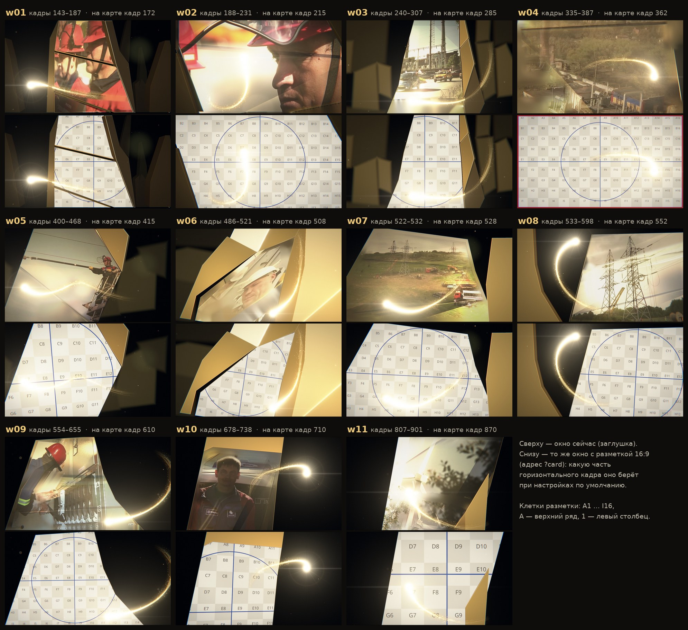
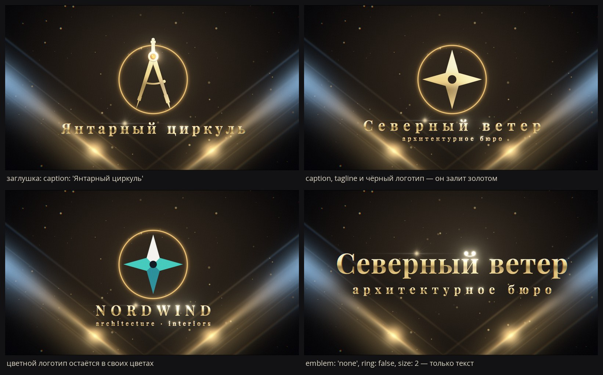
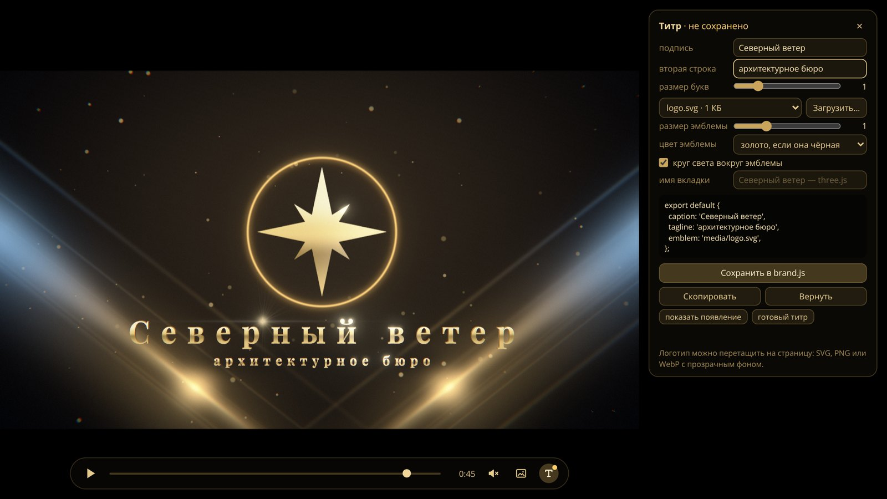
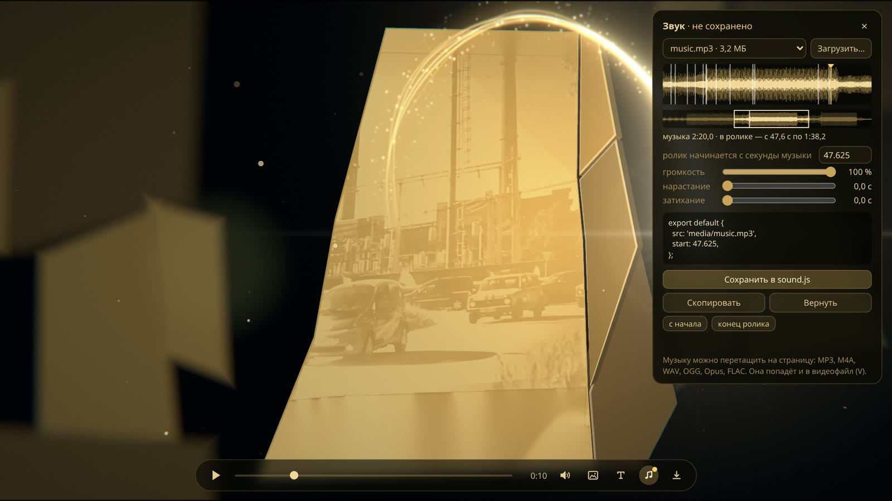
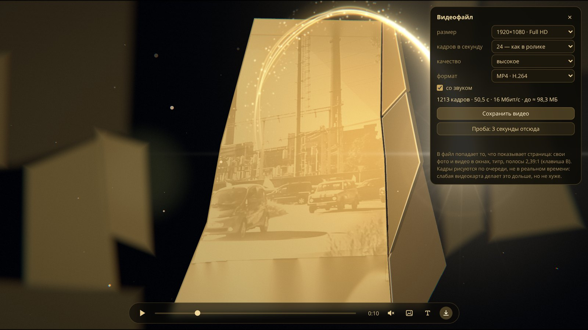

# circle.animaation.proto-2

Анимация на **three.js** по мотивам ролика (1280×720, 24 к/с, 1213 кадров ≈ 50,5 с; сам ролик в репозиторий не входит):
камера летит между золотыми гранёными осколками, на гранях — «окна» с нарезками из `public/media/`, а через весь ролик,
от первого кадра до финальной вспышки, летит один свет со шлейфом. В финале из вспышки появляется эмблема — золотой циркуль, рисующий вокруг себя круг света, — и
подпись «Янтарный циркуль». Название и циркуль — заглушки: своё название и свой логотип ставятся в `src/brand.js`,
свои фото и видео в «окнах» — в `src/media.js`, своя музыка — в `src/sound.js` (разделы ниже; сейчас в файле `off: true` — музыки нет). Готовый ролик
сохраняется как видеофайл, MP4 или WebM, вместе с этой музыкой (раздел «Ролик как видеофайл»).

## Запуск

```bash
npm install
npm run dev       # http://localhost:5173
npm run build     # статическая сборка в dist/ (относительные пути, можно открыть с любого хостинга)
```

Управление: **Пробел** — пауза/воспроизведение, **← / →** — ±1 с (с **Shift** — ±1 кадр), **M** — звук, **B** — киношные
полосы 2,39:1; в `npm run dev` ещё **E** — подгонка своих кадров в окнах, **T** — название и логотип в финальном титре,
**S** — своя музыка (сейчас выключена) и **V** — сохранить ролик как видеофайл (все четыре инструмента описаны ниже).
Параметры адреса: `?f=<кадр>` или `?t=<секунды>` — начать с этого места, `?paused` — не запускать, `?dpr=1` — задать плотность
пикселей вручную (и отключить автоподбор качества), `?scope` — сразу с полосами 2,39:1, `?card` — разметка 16:9 в окнах
вместо картинок (см. ниже), `?nowarm` — пропустить прогрев (для покадровой съёмки), `?edit`, `?title`, `?sound` и
`?video` — сразу открыть один из инструментов.
В консоли доступен `window.__player` (`renderAt(f)`, `seek(t)`, `play()`, `pause()`, `setSound(on)`).

## Свои фото и видео в окнах

В ролике 11 «окон» — граней, на которых показана картинка. В любое из них можно поставить свою фотографию или видео.
Всё задаётся в одном файле, [`src/media.js`](src/media.js):

```js
export default {
  w03: { src: 'media/facade.jpg' },                                 // фото по центру окна
  w05: { src: 'media/house.jpg', x: 0.3, y: 0.4, zoom: 1.2 },       // левая часть кадра, чуть крупнее
  w08: { src: 'media/flight.mp4', start: 2, to: { zoom: 1.08 } },   // видео со 2-й секунды и медленный наезд
  w10: { src: 'media/tower.jpg', fixed: true },                     // кадр стоит на экране, окно пролетает над ним
};
```

Заполнять его можно мышью или руками — как удобнее. Окно без строки остаётся пустым стеклом: заглушек-стопкадров в
проекте нет. Если файл не найден или не открывается, окно тоже остаётся пустым, а в консоли браузера появляется
предупреждение. В сборку (`npm run build`) файлы из `public/media/` попадают сами.

### Мышью: «Подгонка кадра»

Запустите `npm run dev`, откройте страницу и нажмите **E** — или кнопку с картинкой в панели управления, или добавьте
к адресу `?edit`. Справа появится панель, а на окнах — их номера.


- **Поставить файл.** Перетащите фото или видео с компьютера прямо на окно: файл попадёт в `public/media/`, а в
  `src/media.js` появится строка этого окна. То же делает кнопка «Загрузить…». Файлы, которые уже лежат в
  `public/media/`, выбираются из списка; «пусто» в списке убирает файл из окна, и оно остаётся пустым стеклом.
- **Подогнать.** Тяните кадр мышью внутри окна. Колесо — крупнее и мельче, вокруг точки под курсором; **Alt + колесо** —
  поворот. Ползунки в панели делают то же без колеса. «По горизонту» — это `rotate: 'level'`, «закрепить на экране» —
  `fixed`.
- **Движение.** Галочка «движение, пока окно на экране» включает `to`. Кнопкой «к началу» перейдите в начало окна и
  поставьте кадр так, как он должен стоять сначала, затем «к концу» — и так, как в конце.
- **Сохранить.** «Сохранить в media.js» записывает строки всех окон, где что-то сдвинуто; страница при этом не
  перезагружается. Готовая строка всегда показана в панели — её можно и просто скопировать.

Стрелки вверху панели переходят от окна к окну. Фото (JPEG, WebP, AVIF) больше 4096 px по длинной стороне при
загрузке уменьшается до этого размера — больше ролик всё равно не показывает — и сохраняется как JPEG; остальные
файлы кладутся как есть, предел — 95 МБ.

Инструмент — часть dev-сервера, в сборку он не попадает. Записывать он может только на том компьютере, где запущен
сервер, и по адресу `localhost`: если страница открыта с другого устройства, через прокси или по другому имени, кадр
двигается и строка показывается, но сохранить её можно лишь руками. Разрешить запись и оттуда —
`MEDIA_TOOL=remote npm run dev` (в PowerShell: `$env:MEDIA_TOOL='remote'; npm run dev`); делайте так только в сети,
которой доверяете. Файл с именем, которое в `public/media/` уже есть, заменяет прежний.

### Руками: файл `src/media.js`

1. Положите файлы в `public/media/`.
2. Добавьте строку с номером окна: `w01` … `w11`, по порядку появления в ролике (карта ниже).
3. Запустите `npm run dev`, поставьте ролик на паузу на этом окне и подбирайте числа. Положение кадра (`x`, `y`,
   `zoom`, `rotate`, `to`, `fixed`) меняется на экране сразу, как только файл сохранён; после остальных правок
   страница загружается заново и остаётся на том же кадре.



Сверху — окно с кадром, снизу — оно же с разметкой 16:9: видно, какую часть горизонтального кадра окно берёт без
настроек. Ту же разметку в самом ролике показывает адрес с `?card` — например, `http://localhost:5173/?card&f=415&paused`,
— причём уже с вашими `x`, `y`, `zoom` из `src/media.js`.

### Окна

| Окно | Кадры | Длится | Форма (ш : в) | От кадра 16:9 берёт | Доля экрана | Открыть для настройки | Нарезка |
| --- | --- | --- | --- | --- | --- | --- | --- |
| `w01` | 143–187 | 1,9 с | 0,86 | 48 % ширины | ≈ 35 % | `?f=172&paused` | 00.07 Бэйджи |
| `w02` | 188–231 | 1,8 с | 1,74 | почти весь | ≈ 95 % | `?f=215&paused` | 01.25–01.28 Шульган |
| `w03` | 240–307 | 2,8 с | 0,78 | 44 % ширины | ≈ 33 % | `?f=285&paused` | 01.25 Соболь/Анисимов |
| `w04` | 335–387 | 2,2 с | весь экран | весь | 100 % | `?f=362&paused` | 03.36 Общий план зала |
| `w05` | 400–468 | 2,9 с | 1,02 | 57 % ширины | ≈ 44 % | `?f=415&paused` | 03.34 Тихонова |
| `w06` | 486–521 | 1,5 с | 0,90 | 51 % ширины | ≈ 31 % | `?f=508&paused` | 03.52 Зикеев |
| `w07` | 522–532 | 0,5 с | 1,87 | почти весь | ≈ 73 % | `?f=528&paused` | 03.52 Зикеев, 2-я часть |
| `w08` | 533–598 | 2,8 с | 1,23 | 69 % ширины | ≈ 58 %, с кадра 577 уходит за край | `?f=552&paused` | 04.51 Боровская |
| `w09` | 554–655 | 4,3 с | 1,47 | 83 % ширины | сначала ≈ 17 % у левого края, с кадра 577 ≈ 51 % | `?f=610&paused` | 04.59 Юшкевичус |
| `w10` | 678–738 | 2,5 с | 0,74 | 42 % ширины | ≈ 41 % | `?f=710&paused` | 05.41 фотозона |
| `w11` | 807–901 | 4,0 с | 0,75 | 42 % ширины | ≈ 60 % | `?f=870&paused` | 05.44 все победители |

«Форма» — отношение ширины к высоте той части окна, которая хоть раз попадает в экран: камера часто подлетает так близко,
что целиком окно не видно, и то, что остаётся за кадром, место в вашей картинке не занимает. Вертикальному окну
(форма меньше 1) лучше подходит вертикальный кадр — от горизонтального оно возьмёт только среднюю часть. Кадр `w04`
закреплён на экране (см. `fixed`), поэтому он виден целиком.

### Нарезки Cirkul 2024 (окна)

В ролике заняты **все одиннадцать окон**, и показывают они только эти нарезки — стопкадров-заглушек в проекте нет.
Нарезки — горизонтальные 1920×1080 из папки `cuts` (на Google Диске — `arena.ai/circle/video/`); в `src/media.js`
прописаны локальные имена под `public/media/`, где сами файлы и лежат в репозитории. Если какого-то файла не хватает,
окно остаётся пустым стеклом — тёмной гранью без картинки, — а не подменяется чужим кадром.

**Медленное соединение.** Нарезки — это 114 МБ на одиннадцать файлов, и на слабом канале какой-то из них не успевает
прийти к началу ролика. Тогда окно открывается пустым и **подхватывает свою нарезку, как только та сможет играть**:
положение в окне, движение и часы ролика — те же, что были бы, приди файл вовремя (в консоли это видно как
`media.js: turbines took its video`). Файла, который браузер не может открыть вовсе (404, неподдерживаемый кодек),
окно не ждёт — оно так и остаётся пустым. Свои файлы лучше сжимать (см. `ffmpeg` ниже): чем меньше вес, тем реже это
вообще случается.

| Окно | Файл в public/media/ | Что за нарезка | Примечание |
| --- | --- | --- | --- |
| `w01` | `badges.mp4` | «00.07 Бэйджи.mp4» | спокойное вступление, 0–1,15 с |
| `w02` | `shulgan.mp4` | «01.25-01.28 Шульган.mp4» | почти весь экран, 0–1,8 с |
| `w03` | `sobol-anisimov.mp4` | «01.25 СобольАнисимов.mp4» | 0–2,4 с |
| `w04` | `hall.mp4` | «03.36 Общий план зала.mp4» | весь экран, `fixed` |
| `w05` | `tikhonova.mp4` | «03.34 Тихонова.mp4» | 0–2,6 с |
| `w06` | `zikeev.mp4` | «03.52 Зикеев.mp4» | окно 1,5 с — вручение крупным планом, 0,4–1,9 с |
| `w07` | `zikeev.mp4` | «03.52 Зикеев.mp4», вторая часть | окно 0,5 с — та же нарезка с 2,1 с: сцена целиком |
| `w08` | `borovskaya.mp4` | «04.51 Боровская.mp4» | идёт в паре с `w09` |
| `w09` | `yushkevichus.mp4` | «04.59 Юшкевичус.mp4» | окно 4,3 с |
| `w10` | `photozone.mp4` | «05.41 фотозона.mp4» | нарезка 14,4 с — в окне зацикливается |
| `w11` | `winners.mp4` | «05.44 все победители.mp4» | финал, перед вспышкой |

Нарезок десять, а окон одиннадцать, поэтому `w07` (0,5 с) берёт **вторую часть** той же нарезки, что и `w06`: окна идут
одно за другим (кадры 486–521 и 522–532), и «Зикеев» продолжается в `w07` с 2,1 с общим планом сцены. Это две строки на
один файл — два независимых `<video>`: браузер берёт MP4 из кэша, лишней загрузки нет, а в окнах идут разные моменты.
`w07` горизонтальный (1,87 : 1), общий план ложится в него лучше, чем крупный.

Обрезку/петлю длинных нарезок трогать обычно не нужно: окно живёт 1,5–4,3 с и показывает свою часть видео «по часам
ролика» (длинное просто не доигрывает). Лица в вертикальных окнах (`w01`, `w03`, `w06`, `w10`, `w11`) берут из
горизонтального кадра по центру; если лицо обрезано — сдвиньте кадр `x`/`y` или добавьте `zoom` (клавиша **E**).

### Настройки

| Ключ | Что делает | Без него |
| --- | --- | --- |
| `src` | файл в `public/media/`: фото (jpg, png, webp, avif) или видео (mp4, webm) | — |
| `x`, `y` | какую часть кадра показать, от 0 до 1: `x: 0` — левый край, `1` — правый; `y: 0` — верх, `1` — низ | `0.5` — середина |
| `zoom` | увеличение, от 1: при `1` кадр ровно закрывает окно, больше — крупнее | `1` |
| `rotate` | поворот кадра по часовой стрелке, в градусах; `'level'` — выровнять кадр по горизонту экрана (окна `w06`–`w08` наклонены на 3–8°) | `0` |
| `to` | `{ x, y, zoom, rotate }` — к чему плавно прийти, пока окно на экране: медленный наезд, отъезд или панорама | кадр неподвижен в окне |
| `fixed` | `true` — кадр закреплён на экране и занимает его целиком, а окно — прорезь, через которую он виден; `false` — кадр «наклеен» на окно и летит вместе с ним | `false`, для `w04` — `true` |
| `start` | видео: с какой секунды начать | `0` |
| `rate` | видео: скорость (`0.5` — вдвое медленнее) | `1` |
| `loop` | видео: `false` — не повторять, остановиться на последнем кадре | повтор по кругу |
| `sharpen` | подчеркнуть резкость мягкого исходника, от 0 до 1 | `0` |

Кадр всегда закрывает окно целиком, как `object-fit: cover` в CSS, а `x` и `y` работают как `object-position`: ни при
каких числах у края окна не появится пустое поле, в том числе с поворотом.

**Наклеен или закреплён.** Обычный кадр летит вместе с окном: наклоняется, уходит в перспективу, приближается — так
ведут себя нарезки. С `fixed: true` кадр стоит на экране ровно и без искажений, а над ним пролетает окно — вертикали
здания остаются вертикалями. Для архитектуры это часто выигрышнее; попробуйте оба варианта.

### Какие файлы подойдут

- **Фото.** Соотношение сторон любое. Для показа во весь экран на Full HD хватает 2500–3000 px по длинной стороне; в
  окнах `w05`, `w06`, `w10`, `w11` камера подлетает ближе — там пригодятся 4000 px. Больше 4096 px не нужно: при
  загрузке фото уменьшается до этого размера.
- Снимки с телефона и камеры можно класть как есть: цветовой профиль (Display P3, Adobe RGB) пересчитывается в sRGB,
  а поворот, записанный в EXIF, учитывается — вертикальный кадр встаёт вертикально. HEIC браузеры не открывают:
  сохраните такой снимок как JPEG. Прозрачные места PNG становятся чёрными.
- **Видео.** mp4 (H.264) или webm, 1920×1080 достаточно. Идёт без звука и по часам ролика: начинается, когда окно
  проявляется, встаёт на паузу и перематывается вместе с роликом. Окна живут от 0,5 до 4,3 секунды (столбец «Длится») —
  более длинное видео просто не успеет показаться.
- Все файлы запрашиваются перед стартом ролика (фото он ждёт целиком, у видео — первый кадр), так что видео стоит
  обрезать до нужных секунд и сжать, например:
  `ffmpeg -ss 12 -t 6 -i source.mov -an -vf scale=1920:-2 -c:v libx264 -crf 22 -pix_fmt yuv420p -movflags +faststart public/media/flight.mp4`.

### Что стоит знать

- Проявление окна (из золота и сепии в цвет) и общая цветокоррекция ролика действуют и на свои кадры — это часть стиля.
- Свет летит по своему маршруту, поставленному так, чтобы не пересекать лица на нарезках. По вашему кадру он может
  пройти в важном месте — тогда сдвиньте кадр через `x` и `y`.
- Камера в полёте кренится, поэтому горизонт в «наклеенном» кадре немного гуляет: `rotate: 'level'` убирает наклон
  в середине плана, но не весь. Ровнее всего — `fixed: true`.
- Окна `w08` и `w09` видны одновременно. До кадра 577 главное `w08`, а `w09` выглядывает у левого края; затем `w09`
  выходит в центр, а `w08` к кадру 598 уходит за край.
- Окно `w07` на экране всего полсекунды; `w04` занимает весь экран и поэтому по умолчанию закреплено.
- Заглушки в некоторых планах слегка двигаются внутри окна, как в исходном ролике. Свой кадр стоит на месте, пока
  ему не задано движение через `to`.

## Своё название и логотип в финале

Финальный титр — эмблема в круге света и подпись под ней. «Янтарный циркуль» и сам циркуль — заглушки. Своё название и
свой логотип задаются в одном файле, [`src/brand.js`](src/brand.js):

```js
export default {
  caption: 'Северный ветер',          // подпись
  tagline: 'архитектурное бюро',      // вторая строка мелкими буквами
  emblem: 'media/logo.svg',           // своя картинка вместо циркуля: файл из public/media/
};
```



Заполнять его можно на странице или руками — как удобнее.

### На странице: «Титр»

Запустите `npm run dev`, откройте страницу и нажмите **T** — или кнопку с буквой «T» в панели управления, или добавьте
к адресу `?title`. Ролик встанет на готовом титре, а справа от него появится панель.



- **Текст.** Наберите подпись и вторую строку — титр меняется, пока вы печатаете. «Размер букв» — это `size`,
  «имя вкладки» — `name`.
- **Логотип.** Перетащите файл с компьютера на страницу или нажмите «Загрузить…»: он попадёт в `public/media/` и
  встанет на место циркуля. Файлы, которые там уже лежат, выбираются из списка; в нём же — циркуль и «без эмблемы».
  У своей картинки есть «размер эмблемы» (`emblemSize`) и «цвет эмблемы» (`emblemGold`: залить золотом, оставить свои
  цвета или «золото, если она чёрная»). Галочка «круг света вокруг эмблемы» — это `ring`.
- **Посмотреть.** Кнопка «показать появление» проигрывает титр от вспышки, «готовый титр» возвращает на кадр 1100.
  Пробел, стрелки и **B** работают как обычно — пока курсор не стоит в текстовом поле; выйти из поля — **Enter**
  или **Esc**.
- **Сохранить.** «Сохранить в brand.js» записывает строки в файл; страница при этом не перезагружается, комментарии и
  примеры в файле остаются на месте. Тот же блок всегда показан в панели — его можно и просто скопировать. «Вернуть»
  отменяет всё, что не сохранено.

Панель сама говорит, если в шрифте нет набранного знака, если картинка не открылась, если буквы под эмблемой больше не
растут и если с полосами 2,39:1 нижняя строка уходит под полосу. Несохранённое переживает перезагрузку страницы (но не
закрытие вкладки); пока оно есть, на кнопке «T» горит точка — ролик показывает не то, что записано в файле.

В окне от 760 px шириной панель стоит рядом с роликом, а не поверх него: титр виден целиком. В более узком она
ложится на правый верхний угол кадра.

Инструмент — часть dev-сервера, в сборку он не попадает. Записывает он по тем же правилам, что и «Подгонка кадра»:
только на том компьютере, где запущен сервер, и по адресу `localhost` (или с `MEDIA_TOOL=remote npm run dev`); иначе
титр меняется на экране, а блок остаётся скопировать руками. Файл, написанный не так, как пишет инструмент (две
настройки на одной строке, значение на несколько строк), он не трогает и говорит об этом.

### Руками: файл `src/brand.js`

Сохраните файл — титр на открытой странице `npm run dev` сменится сам, без перезагрузки. Адрес
`http://localhost:5173/?f=1100&paused` показывает готовый титр, `?f=1010&paused` — момент, когда круг ещё рисуется.

| Ключ | Что задаёт | Если не задан |
| --- | --- | --- |
| `caption` | Подпись под эмблемой; `''` — без подписи | `'Янтарный циркуль'` |
| `tagline` | Вторая строка мелкими буквами (без подписи встаёт на её место) | строки нет |
| `size` | Размер букв: от 0.5 до 1.6, а без эмблемы и круга — до 3 | `1` |
| `emblem` | `'compass'` — циркуль; `'media/logo.svg'` — своя картинка из `public/media/`; `'none'` — без эмблемы | `'compass'` |
| `emblemSize` | Размер своей картинки, от 0.2 до 3: при 1 она вписана в круг света с небольшим зазором | `1` |
| `emblemGold` | `true` — залить картинку золотом титра по её форме; `false` — оставить её цвета | золотом заливается только почти чёрная |
| `ring` | `false` — без круга света | круг есть |
| `name` | Заголовок вкладки браузера | подпись и « — three.js» |

**Подпись.** Короткая набирается вразрядку, обычная растягивается на ширину строки-заглушки, длинная сама становится
плотнее, а потом и мельче: шире 86 % кадра строка не бывает. Доступен весь шрифт: русские, украинские и белорусские
буквы, латиница с диакритикой (европейские языки, вьетнамский), цифры, знаки препинания, `№ & @ € £ $`. Греческих букв,
части казахских (Ә, Ғ, Қ, Ң, Ө, Ү, Һ), знака рубля, иероглифов и эмодзи в шрифте нет: такой знак пропускается, а в
консоли страницы и в выводе `npm run build` появляется предупреждение. Искорка, гуляющая по верхам букв, и блик,
пробегающий по золоту, подстраиваются под новую строку. Вторая строка появляется чуть позже подписи; под ней лежит
мягкая тень, чтобы мелкие буквы читались поверх световых лучей.

**Логотип.** Подойдёт SVG, PNG или WebP с прозрачным фоном. Прозрачные поля вокруг рисунка не в счёт: он сам вписывается
в круг света — самая дальняя от середины точка рисунка не доходит до круга на 14 % его радиуса; `emblemSize` делает его
крупнее или мельче, `ring: false` убирает круг. Цвета остаются своими. Чёрный или почти чёрный логотип на тёмном фоне
титра был бы не виден, поэтому он заливается золотом титра по своей форме, с тем же бликом, что и буквы;
`emblemGold: true` делает то же с логотипом любого цвета, `false` оставляет как есть. Логотип появляется из вспышки там
же, где циркуль, и круг света рисуется вокруг него.

- SVG: текст переведите в кривые (шрифты внутри картинки браузер не подгружает); в теге `<svg>` нужен `viewBox`,
  а лучше ещё и `width` с `height`.
- PNG и WebP: рисунок от 600–800 px по длинной стороне, меньший будет мягким; больше 1024 px не нужно.
- Картинка без прозрачности (JPEG, PNG с белым фоном) встанет прямоугольником.
- Если файл не найден или не читается, остаётся циркуль, а в консоли страницы появляется предупреждение.

**Только текст или только эмблема.** С `emblem: 'none'` и `ring: false` подпись и вторая строка встают по центру кадра,
и буквы можно сделать крупнее (`size` до 3). С `caption: ''` по центру встаёт одна эмблема.

**Полосы 2,39:1** (клавиша **B**). Подпись под эмблемой остаётся над нижней полосой при любом `size`, вторая строка —
при `size` до 1.1; при большем она к концу ролика уходит под полосу.

**Имя страницы.** Заголовок вкладки, описание страницы и надпись на экране загрузки берутся из подписи; `name` задаёт
заголовок вкладки целиком.

**Сборка.** В файле шрифта лежат контуры всех его знаков (570 КБ), поэтому любую подпись можно попробовать сразу.
В сборку (`npm run build`) попадают только знаки подписи и второй строки: сменили текст — соберите сайт заново.

**Как это проверялось.** В headless Chromium, в других браузерах — нет. С настройками по умолчанию все 1213 кадров
ролика совпадают с прежними до пикселя. `tools/titleshot.mjs` снимает титр с 19 наборами настроек (длинная
и короткая подпись, вторая строка, латиница с диакритикой, цветной, чёрный и белый логотип, логотип с большими
прозрачными полями, только текст, только эмблема, отсутствующий файл, знаки, которых нет в шрифте) и проверяет имя
страницы, предупреждения, то, что открытая страница после сохранения файла показывает новый титр на том же кадре, не
загружаясь заново, и то, что логотип остаётся на месте после потери и восстановления контекста WebGL; сами картинки
оценивались на глаз. `tools/buildtest.mjs` собирает сайт и проверяет, что в сборке остались только нужные знаки, а
собранная страница показывает титр; `tools/captiontest.mjs` — разбор настроек, разрядка строки и файл шрифта.

Панель «Титр» проверяет `tools/titlertest.mjs`: клавиатурой и мышью набирает подпись, двигает ползунки, загружает,
перетаскивает и заменяет логотип, сохраняет — и сравнивает кадр с тем, что рисует заново открытая страница по
сохранённому файлу (совпадают до пикселя, на пяти кадрах титра); отдельно — отказы сервера, файлы, которые инструмент
менять не берётся, страница без права записи. Строки, которые он пишет в файл, проверяет `tools/linetest.mjs`.

## Своя музыка

Ролик идёт со своей музыкой: свой файл, с любого его места, с нарастанием и затиханием. Настройка лежит в одном файле,
[`src/sound.js`](src/sound.js) (в нём же примеры):

```js
export default {
  src: 'media/music.mp3',     // свой файл из public/media/; сейчас в файле стоит `off: true` — музыки нет
  start: 12.5,                // с какой секунды музыки начинается первый кадр ролика
  volume: 0.8,                // 0…1
  fadeIn: 1.5,                // нарастание в начале ролика, секунд
  fadeOut: 3,                 // затихание к концу, секунд
};
```

- **Файл.** Любой, который читает браузер: MP3, M4A (AAC), WAV, OGG (Vorbis), Opus, FLAC. Кладите его в
  `public/media/` и пишите `media/имя.mp3` — или просто перетащите на страницу, а инструмент положит сам (ниже).
  Адрес целиком (`https://…`) тоже можно, если его сервер разрешает читать файл со стороны.
- **Место.** `start` — секунда музыки, которая звучит на первом кадре ролика. Число бывает и отрицательным: тогда
  музыка вступает позже первого кадра — например, `start: -4` включает её на четвёртой секунде ролика. Музыка может
  кончиться раньше ролика: дальше он идёт без неё. Сейчас музыка выключена: в `src/sound.js` написано
  `off: true` — ни на странице, ни в видеофайле звука нет (исходная дорожка `public/audio.m4a` удалена). Чтобы
  вернуть — впишите свой `src: 'media/имя.mp3'` (любое заданное `src` включает звук) или выберите файл в инструменте «Звук».
- **Громкость и края.** `volume` — общая громкость, `fadeIn` и `fadeOut` — нарастание от первых кадров и затихание к
  последним (по квадрату времени, как это делает свет в кино). Всё это слышно и на странице, и в видеофайле.
- **Тишина.** Клавиша **M** выключает звук на странице (сейчас кнопка скрыта: музыка убрана); в видеофайл музыка попадает всё равно, пока не выключена в `src/sound.js` — с `off: true` файл всегда выходит тихим.



**Инструмент «Звук»** (клавиша **S**, `?sound` или кнопка с нотой в панели управления) ставит всё это мышью:

- файл выбирается в списке (`public/media/`), кнопкой «Загрузить…» или перетаскиванием на страницу — перетащить
  можно и музыку, и с открытым инструментом «Подгонка кадра», и с открытым «Титром»: она всё равно попадёт сюда;
- полоса ролика сверху — весь ролик: белые метки на ней — склейки планов, золотая с точкой — вспышка; полоса снизу —
  вся музыка, а рамка на ней — кусок, который звучит под роликом. Тяните рамку — музыка поедет относительно ролика;
  щёлкните по музыке мимо рамки — рамка придёт туда;
- «ролик начинается с секунды музыки» — то же число, что `start`, ползунки — громкость, нарастание и затихание;
- «с начала» и «конец ролика» проигрывают начало и последние секунды, чтобы услышать края;
- «Сохранить в sound.js» пишет настройки в файл (и открытая страница сразу играет по ним, не загружаясь заново);
  «Скопировать» даёт тот же блок в буфер обмена — если страница открыта не на своём компьютере и писать в файл не
  может. «Вернуть» возвращает то, что в файле.

Инструмент — часть dev-сервера: в сборку он не попадает, а `src/sound.js` остаётся обычной настройкой.

**В видеофайле.** Музыка попадает в него как есть, если её формат совпадает с форматом файла (MP3 и M4A → MP4, Opus
→ WebM): дорожка не перекодируется, а перед первым кадром в файл кладутся несколько её пакетов до начала — так
декодеру есть с чего начать, — и файл помечает их как непроигрываемые, чтобы музыка начиналась ровно с кадром. В
других случаях (и всегда в WebM из MP3 или WAV) музыка перекодируется в AAC 128 кбит/с на канал (MP4) или в Opus
96 кбит/с на канал (WebM), и файл звучит столько же, сколько картинка. Если браузер не умеет ни прочитать музыку, ни
закодировать её в нужный формат, файл выходит без звука, а панель говорит почему.

**Как это проверялось.** В headless Chromium, в обычных браузерах — нет; на слух — только через колонки этого
компьютера, а измерительные проверки читают файлы и звук числами. `tools/soundtest.mjs` (135 проверок) водит
инструмент настоящими клавишами и мышью: что сервер принимает и что отвергает, что попадает в файл, полосы,
сохранение и отмену, загрузку, перетаскивание и замену файла под тем же именем, страницу без права записи; отдельно —
идущий ролик в реальном времени: музыка вступает и уходит там, где сказано, следует за часами ролика, громкость и
края — по настройкам. `tools/exporttest.mjs` (часть «music», 28 проверок) делает файлы и читает их обратно через
ffmpeg: где в них стоят удары музыки (до миллисекунды), какова громкость до, во время и после нарастания, совпадают
ли звук и пакеты с самим файлом музыки, звучит ли файл в браузере, когда музыка в него скопирована. Целый ролик с
музыкой (`FULL=1`) сделан один раз: 1213 кадров и звук во всю длину.

## Ролик как видеофайл

Ролик — со своими фото, видео и названием — сохраняется как обычный видеофайл: для соцсетей, презентации, монтажа.
Запустите `npm run dev`, откройте страницу и нажмите **V** — или кнопку со стрелкой вниз в панели управления, или
добавьте к адресу `?video`.



- **Что попадает в файл.** То, что показывает страница: свои фото и видео в окнах, титр — и несохранённый тоже, как он
  набран в панели «Титр», — и полосы 2,39:1, если они включены клавишей **B**. Звук — та музыка, что задана в
  `src/sound.js`; с `off: true` (стоит сейчас) файл всегда выходит без звука, и галочка «со звуком» не действует.
  Иначе — со своим местом, громкостью и краями и даже если на странице звук выключен; без галочки «со звуком» файл
  выходит немым. Рядом с галочкой написано, какая музыка пойдёт в файл (или что звук выключен).
- **Размер.** 1280×720, 1920×1080, 2560×1440 или 3840×2160. Это не запись экрана: каждый кадр рисуется заново ровно
  в этом размере, каким бы ни были окно браузера и монитор.
- **Кадров в секунду.** 24 — как в ролике, 30 или 60. Ролик можно нарисовать для любого момента времени, поэтому 60 —
  это 60 разных картинок в секунду, а не повторы; длится файл столько же.
- **Качество.** «Обычное», «высокое» и «наивысшее» — это 8, 16 и 32 Мбит/с для 1920×1080 при 24 кадрах в секунду; для
  других размеров и частот число пересчитывается. Строка под настройками говорит, что получится: сколько кадров и
  секунд и до какого размера может дорасти файл. Это потолок: на спокойных сценах кодировщик тратит меньше.
- **Формат.** MP4 (H.264 и AAC) открывается везде — в телефоне, в соцсетях, в монтажной программе; звук кладётся
  в него без перекодирования, если музыка и так в AAC (например, M4A), а MP3, WAV, OGG и FLAC
  перекодируются в AAC. WebM (VP9 и Opus) — для веб-страниц; на проверке он при том же качестве выходил вдвое-втрое
  меньше. Как именно музыка попадает в файл — в разделе «Своя музыка».
- **Проба.** «Проба: 3 секунды отсюда» делает файл из трёх секунд, начиная с кадра на экране, с теми же настройками:
  по нему видно, каким выйдет ролик и сколько времени уйдёт на целый.
- **Сохранить.** «Сохранить видео» рисует ролик кадр за кадром — не в реальном времени, поэтому кадры не теряются и
  не опаздывают: слабая видеокарта делает это дольше, но не хуже. Панель показывает, какой кадр готов и сколько
  осталось; «Стоп» прекращает работу, файла при этом не остаётся. Готовый файл браузер скачивает сам, под названием
  ролика — например, «Янтарный циркуль 1920x1080.mp4». Ссылка на него остаётся в панели до следующего файла: если
  загрузка не началась сама, нажмите на неё.

Пока файл делается, страница занята: клавиши и мышь на ролик не действуют, панель управления убрана, а при попытке
закрыть вкладку браузер переспросит. Настройки панель запоминает.

Что стоит знать:

- **Браузер.** Видео кодирует сам браузер (WebCodecs): нужен свежий Chrome или Edge, а страница должна быть открыта по
  адресу `localhost` или по https. Если браузер не кодирует выбранный формат в выбранном размере, панель говорит об
  этом и берёт другой формат; если не кодирует ничего — просит размер поменьше. Если не получается звук, файл
  выходит без него, и панель говорит почему.
- **Время.** Зависит от видеокарты и размера кадра — проба покажет его на трёх секундах. Измерено оно только там, где
  видеокарты нет и рисует процессор: 0,4 с на кадр 640×360, 3,5 с на кадр 1920×1080 (больше часа на ролик) и около
  19 с на кадр 3840×2160. С видеокартой должно быть во много раз быстрее, но это не проверялось.
- **Память.** Файл собирается в памяти страницы и скачивается, когда готов. «До ≈ … МБ» в панели — это и размер
  файла, и память, которую он займёт: для 3840×2160 счёт идёт на сотни мегабайт.
- **Видеокарта.** Если ей не хватает памяти на выбранный размер, файл не делается, а панель просит размер поменьше.
- **Своё видео в окне** идёт в файле по часам ролика кадр в кадр: перед каждым кадром ролика оно ставится на нужное
  место, и кадр рисуется, только когда картинка видео действительно та. Поэтому с видео в окнах файл делается
  медленнее.
- **Вкладка.** Кадры рисуются не в такт экрану, так что работа идёт и тогда, когда страницу не видно. Проверено это
  только в headless-браузере со свёрнутым окном; в обычном браузере надёжнее держать вкладку на виду, особенно если
  в окнах стоит видео.
- **Сжатие.** H.264 и VP9 хранят цвет с половинным разрешением и слегка сглаживают зерно. Труднее всего им искры
  после вспышки (кадры 975–1000): там при любом качестве картинка мягче, чем на странице.

Инструмент — часть dev-сервера, в сборку он не попадает. Файл складывает библиотека
[mediabunny](https://mediabunny.dev/) (лицензия MPL-2.0) — зависимость для разработки: она ставится вместе с
`npm install`, загружается на страницу, когда панель открывают в первый раз, и в `dist/` не входит.

**Как это проверялось.** В headless Chromium без видеокарты; в обычных браузерах, в Firefox и Safari — нет.
`tools/exporttest.mjs` (101 проверка) делает файлы настоящими кнопками панели и читает их обратно через ffmpeg:

- дорожки, число кадров и их время; каждый кадр — против того же кадра ролика, снятого со страницы без потерь; звук
  MP4 — против `audio.m4a` отсчёт в отсчёт, звук WebM — по сходству и сдвигу;
- 30 и 60 кадров в секунду, файл крупнее страницы, полосы, титр, набранный в панели «Титр» и не сохранённый;
- видео в окне (MP4 и WebM, 24 и 30 кадров в секунду, в файлах на 24 и 60 кадров): стоит ли оно на нужном кадре
  в момент, когда рисуется каждый кадр файла, — и то же со свёрнутым окном браузера;
- «Стоп», уход со страницы посреди работы, потеря контекста WebGL и нехватка памяти видеокарты, браузер без нужного
  кодировщика (его ответы подменялись);
- своя музыка: где в файле её удары (MP3, M4A, OGG, Opus, FLAC и WAV, скопированные и перекодированные), её
  громкость и края, файл без звука и слова панели о том, почему;
- после файла страница рисует свой кадр бит в бит как до него.

Почти все файлы — 320×180 (без видеокарты иначе слишком долго), один — 1280×720, и один раз — ролик целиком: 1213
кадров, 50,5 с, звук до последнего отсчёта тот же. В размерах 2560×1440 и 3840×2160 сделано по два-три кадра: файлы
получаются и совпадают с роликом, нарисованным в этом размере. Целый ролик в большом размере, скорость и кодировщики
настоящей видеокарты и вкладка в фоне в обычном браузере не проверялись.

## Как устроено

| Путь | Что там |
| --- | --- |
| `src/main.js` | плеер: часы, прогрев, автоподбор качества, сквозные переходы между планами |
| `src/core/stage.js` | рендерер, bloom и финальный проход: блики (flare), вспышка, виньетка, зерно |
| `src/fx/shards.js` | геометрия и материал осколков (грани, фаски, видеокадр на грани, сепия → цвет) |
| `src/fx/hero.js` | свет, летящий через весь ролик: лента шлейфа (ядро, нити, искры), свечение головы, заход за осколки |
| `src/fx/dust.js` | пылинки в воздухе: расфокусированные точки, сквозь которые летит камера |
| `src/fx/burst.js`, `src/fx/title.js` | вспышка с искрами и финал: эмблема (циркуль или своя картинка), круг света, подпись, лучи, боке |
| `src/brand.js` | настройки финального титра: подпись, вторая строка, эмблема (см. выше) |
| `src/fx/titleSettings.js`, `src/fx/caption.js` | разбор этих настроек (им же пользуется сборка) и разрядка строки |
| `src/shots/shot.js`, `src/shots/index.js` | общий «движок» плана (камера, осколки, окна, пыль, блики) и список планов с их стыками |
| `src/shots/sNN.js` | «режиссура» плана: тайминги, яркость, проявление окон |
| `src/shots/data/sNN.json` | восстановленные по видео данные плана: камера по кадрам, многоугольники осколков (плюс служебное для `tools/`, в сборку не попадает) |
| `src/shots/data/hero.json` | запечённый полёт света: на каждый кадр — голова и 22 точки шлейфа с глубиной (делает `tools/heropath.py`) |
| `src/media.js` | настройки: какие свои фото и видео стоят в окнах (см. выше) |
| `src/sound.js` | настройки музыки: файл, с какого его места, громкость, края (см. выше) |
| `src/dev/` | инструменты dev-сервера: «Подгонка кадра» (**E**), «Титр» (**T**), «Звук» (**S**) и «Видеофайл» (**V**); в сборку не входят |
| `src/core/soundtrack.js`, `src/core/soundSettings.js` | звук ролика: `<audio>`, следующий за часами ролика, и разбор `src/sound.js` |
| `src/core/slots.js`, `src/core/assets.js` | окна как слоты: вписывание кадра в окно, закреплённый кадр, видео по часам ролика; загрузка файлов |
| `public/media/` | нарезки `cuts` и свои фото, видео и музыка |
| `public/audio.m4a` | _удалена_ — дорожка исходного ролика в ролике не используется |
| `tools/` | рабочие скрипты: получение данных из ролика (его самого в репозитории нет — путь задаётся переменной `REFERENCE` в `tools/setup.sh`), сглаживание камеры (`smoothcam.py`), маршрут света (`heropath.py`), ретушь стоп-кадров (`texclean.py`, `restitch.py`), покадровая съёмка в headless Chromium и замеры плавности |

Все координаты в описаниях планов заданы в пикселях исходного видео и в номерах его кадров (`кадр = t·24 + 1`),
поэтому любой момент можно сверить с оригиналом один к одному.

## Планы

| Кадры | План |
| --- | --- |
| 1–47, 48–69, 70–141 | золотые осколки: крупный план, кристалл, «город» монолитов |
| 142–187, 188–231, 232–307 | окна «рабочие», «крупный план», «завод» |
| 308–334 | крупный план золота |
| 335–387, 388–468, 469–521 | окна «подстанция», «монтажник», «каска» |
| 522–532, 533–576, 577–655, 656–738 | окна «поле с опорами», «опоры», «шкаф», «молодой человек» |
| 739–901 | облёт узкого осколка, на нём проявляются ветрогенераторы |
| 902–962 | темнота: свет по спирали уходит в центр кадра |
| 963–1213 | вспышка (пик на кадре 974), искры; циркуль раскрывается (984–1008) и рисует круг (1000–1040), появляется подпись (1022–1050); медленный наезд до конца. Циркуль и подпись — заглушки (`src/brand.js`) |

## Плавность движения

Камера нигде не останавливается и не дёргается — это обеспечивают несколько независимых вещей:

- **Траектория камеры.** Снятая с видео покадровая траектория дрожит и местами «залипает», поэтому она сглажена
  (`tools/smoothcam.py`, параметры по планам — в `tools/smoothcam_opts.json`): положение и поворот проходят через сглаживающий
  сплайн, а там, где трекинг ненадёжен, камера продолжает лететь с той же скоростью. Между ключами камера считается сплайном,
  поэтому на мониторе 60–144 Гц движение идёт на каждом кадре экрана, а не 24 раза в секунду.
- **Свет.** Через весь ролик летит один свет — от первого кадра до финальной вспышки. Его маршрут не снят с видео, а
  поставлен заново (`tools/heropath.py`): по опорным точкам строится траектория с наименьшими рывками — без остановок, резких
  поворотов и скачков в сторону; на склейках свет остаётся в той же точке экрана и летит дальше в том же направлении.
  Шлейф — это след, который голова оставляет за собой: его сносит вместе со сценой, поэтому он всегда тянется за головой одной
  непрерывной лентой — не рвётся, не складывается и не двоится. Маршрут огибает осколки и «окна» и не проходит по лицам; в
  трёх местах свет уходит за осколок и выходит с другой стороны (за осколком он виден приглушённо, так что хвост не
  пропадает). Полёт запечён по кадрам в `src/shots/data/hero.json`, а между кадрами считается сплайном, поэтому на мониторе
  60–144 Гц свет идёт так же ровно, как камера.
- **Сквозные переходы** (кадры 335, 469, 577, 656, 739 — там, где в ролике нет склейки). Два соседних плана связаны одним
  пролётом: скорость камеры плавно перетекает из одной траектории в другую, картинка растворяется через второй буфер, общий
  осколок на стыке 577 — буквально одна и та же геометрия в обоих планах, блики соседних планов сводятся в один.
- **Движение внутри окон.** В плане 817–901 кадр скользит и масштабируется внутри осколка так же, как в оригинале
  (`tools/uvtrack.py`), в плане 656–738 камера ведётся по самому изображению в окне — иначе при медленном пролёте окно
  выглядит замершей фотографией.
- **Яркость без «хлопков».** Блики появляются и гаснут за несколько кадров, окна проявляются по перцептивной кривой,
  яркость видеокадра ограничена ниже порога bloom, а золото вокруг света подсвечивается с плавно меняющейся глубины —
  яркость кадра нигде не меняется скачком.
- **Часы.** Картинка идёт по `requestAnimationFrame`, то есть ровно в такт монитору; звук подстраивается под неё незаметным
  изменением скорости (±1,5 %), а не наоборот: время аудио обновляется неравномерно, и от него движение дрожит.
- **Прогрев.** За экраном загрузки компилируются все шейдеры, загружаются текстуры и по разу рисуется каждый план (на миниатюре),
  поэтому на склейках нет подтормаживаний первого кадра.
- **Автоподбор качества.** Внутреннее разрешение ограничено (`MAX_PIXELS` в `src/main.js`) и снижается на ступень, если
  видеокарта около секунды не успевает за монитором. Вверх оно не возвращается, так что качество не «скачет».

### Как это проверялось

Сцена снималась покадрово в headless Chromium ([`@sparticuz/chromium`](https://github.com/Sparticuz/chromium) + `puppeteer-core`,
WebGL через SwiftShader) — все 1213 кадров, затем по кадрам считался оптический поток и сравнивался с оригиналом
(`tools/seq.mjs` → `tools/imgflow.py` → `tools/final_check.py`). Chromium нужен только для проверки, в зависимости проекта он не входит;
окружение для проверки собирает `bash tools/setup.sh`, рабочие заметки по всему конвейеру — в `tools/NOTES.md`.

| Показатель (до титра, кадры 1–962) | Оригинал | До правки | Сейчас |
| --- | --- | --- | --- |
| кадры без движения (сдвиг < 0,5 px) | 0 | 13 | **0** |
| скачки картинки за один кадр вне склеек | 4 | 10 | **0** |
| скачок на сквозных переходах 577 / 739 | — | 197 px / 129 px | **нет** |
| неравномерность скорости в медленных планах 142–231, px/кадр² (95-й процентиль) | 2,9 / 1,7 | 3,1 / 1,8 | **0,3 / 0,1** |

Полёт света проверяется отдельно, с шагом меньше кадра (`tools/heroprobe.mjs`), в координатах кадра 1280×720:

| Свет | Было (шлейфы, снятые с видео) | Сейчас |
| --- | --- | --- |
| сколько шлейфов | 23 отдельных, со скачками на склейках и разрывами | **один**, от кадра 1 до вспышки |
| скорость головы, px/кадр | — | 10,6–26,7 (в финальном рывке к центру — до 38) |
| ускорение головы, px/кадр² | — | ≤ 3,4 (в финальном рывке — 8,9) |
| самый резкий поворот головы за кадр | — | ≤ 13,6° (в финальной спирали — 25°) |
| длина шлейфа, px (минимум после появления) | — | ≥ 509 |
| самый острый излом ленты | — | ≤ 36° |

Кроме того, `tools/facecheck.py` следит, чтобы свет не перекрывал лица людей в «окнах»: для каждого лица считается,
насколько близко к нему подходит лента (сейчас — не ближе 1,25 радиуса лица), а `tools/offcheck.py` — чтобы середина
шлейфа не уходила за край кадра.

## Кинематографичность

- **Земля и монолиты.** Сцена теперь стоит «на скале»: пол тёмного полированного обсидиана ниже самого глубокого осколка плана (`shots/shot.js`), и в нём отражается всё золото (зеркальная копия мира, отражённая относительно плоскости пола). Каждый цельный гранёный осколок доращён гранёными контрфорсами до этой плоскости — ничто не висит в воздухе; камера по-прежнему летит рядом с монолитами, проходя между ними. Сам монолит «всячески блестит»: яркая грань-ореол на силуэте (rim), перелив по плоскостям во времени, редкие колкие искры по блику (view-dependent glitter, только на освещённом золоте), подсвеченные фаски и блики-огоньки источников света в кадре.
- **Свет** — не тонкая линия, а пучок светящихся нитей с мягким ореолом и искрами: у головы он собран в одну горячую
  линию, дальше расходится веером и тает. Свет на белом не виден (белое плюс свет — всё равно белое), поэтому картинка
  под ним сначала слегка окрашивается в янтарь: на светлом небе вокруг света появляется золотой ореол, и он читается
  так же ясно, как на тёмном фоне. Золото вокруг подсвечивается самим светом, блик объектива следует за головой.
- **Маршрут.** Свет ведёт взгляд: обходит окно по краю, поднимается перед лицом, а не по нему, уходит за осколок и
  возвращается, перед финалом по спирали сходится в центр кадра.
- **Оптика.** Блики — мягкое свечение с редкими лучами и длинной горизонтальной (анаморфотной) полосой чуть холоднее самого
  света, а не жёсткая многолучевая звезда; к углам кадра — лёгкая цветная кайма и виньетка.
- **Цвет.** Двухтоновая «плёночная» градация: в чёрном остаётся капля холода, света уходят в янтарь; чуть больше контраста в
  средних тонах, плёночное зерно.
- **Воздух.** В каждом плане висят пылинки: ближние проплывают мимо объектива большими расфокусированными дисками, дальние
  искрят. Они настоящие точки в пространстве сцены (осколки их заслоняют) и дают полёту глубину и скорость.
- **Финал.** Свет, пролетевший через весь ролик, заканчивает его: в центре кадра он становится вспышкой, из которой
  появляется эмблема, а затем точка света обводит круг вокруг раскрывшегося циркуля.
- **Полосы 2,39:1** — по желанию (клавиша **B** или `?scope`); по умолчанию кадр остаётся 16:9, как в исходнике.

Сила градации, каймы и зерна — `uGrade`, `uFringe`, `uGrain` в `src/core/stage.js`; пыль плана — `dust` в `src/shots/sNN.js`
(0 — выключить).

## Качество картинки

- **Контраст и «молочность».** Кадр выходил светлее и площе оригинала: у того тени много глубже, а у нас золото
  читалось ровной заливкой. Теперь в финальном проходе (`src/core/stage.js`) стоит S-кривая в отображаемом
  пространстве поверх средних тонов — она тождественна в чёрном и в белом и гаснет ниже среднего, так что тёмный кадр
  (вспышка у f1000) не проваливается в чёрный, — а дымка снимается с чёрного умножением. Глубина граней делается не
  только светом: у плоского альбедо грань, отвернувшаяся от всего, выходила такой же светлой, как обращённая к свету,
  поэтому тон грани теперь идёт по более крутой кривой (`uToneContrast` в `src/fx/shards.js`).
- **Стекло.** У грани, уходящей от глаза, появляется широкий холодный отблеск — как у настоящего стекла, зеркалящего
  небо (`uGlass`, `uGlassTint` в `src/fx/shards.js`). Без него соседние грани отличались только тоном, и сцена читалась
  как крашеная, а не как стеклянная.
- **Разрешение.** Сцена рисуется в разрешении экрана с учётом плотности пикселей (до 3×), но не больше 3072×1728
  (`MAX_PIXELS` в `src/main.js`); сглаживание — MSAA 4× (2× выше 3,8 Мп), анизотропная фильтрация текстур 16×.
- **Кадры в «окнах»** взяты из видео 1280×720, так что их детализация ограничена исходником; в шейдере они слегка
  подрезчены (`uSharp` в `src/fx/shards.js`). В исходнике поверх каждого окна лежит шлейф оригинального света, поэтому
  кадр нельзя просто вырезать:
  - четыре окна — «шкаф», «монтёр», «опоры», «белая каска» — собраны заново из **одного резкого кадра** видео (а не
    усреднением многих, от которого картинка мылится). Шлейф с него убран: где другие кадры показывают то, что под ним, —
    картинка взята из них; где он не уходит до конца плана — измерен и вычтен («опоры») либо закрыт мягким
    продолжением соседних участков (`tools/still_*.py`, общие функции — `tools/stillkit.py`);
  - на двух — «рабочие» и «подстанция» — следы шлейфа, «призраки» и швы убраны ретушью (`tools/texclean.py`,
    `tools/restitch.py`).

  Там, где шлейф оригинала закрывал картинку весь план, настоящего изображения нет: рукав рабочего у шкафа и полоса
  ниже лица в «белой каске» достроены, а не сняты. Нетронутые оригиналы кадров в репозиторий не входят.
- Тёмные полосы и диагональные «швы» внутри некоторых окон — это гранёное стекло оригинала, а не дефект.

## Что совпадает точно, а что приблизительно

- **Близко к оригиналу:** склейки и тайминги, положение и форма «окон» и момент их проявления, вспышка перед финалом.
- **Сделано по-своему:**
  - полёт света. В оригинале свет в каждом плане свой: он появляется, гаснет, на склейках перескакивает, местами шлейфов
    несколько. Здесь это один свет с одним шлейфом, а его маршрут поставлен заново — он **не повторяет** траекторию из видео;
  - финал (эмблема и подпись вместо титра исходника), цветовая градация, вид бликов и света, пыль.
- **Приблизительно:** планы без видеокадров (1–141, 308–334, 739–816) — осколки расставлены по одному опорному кадру,
  параллакс и мелкие грани условные; окружение «окон» упрощено.
- **Первый кадр (1–47) собран плотнее, чем в оригинале.** В нём свет ещё не вошёл, и кадр держит композицию сам: тень за
  гранями глубже, на средних гранях появилась тонкая тёмная полоса-клин с подсвеченной кромкой (`x1`), а по плоской правой
  грани идёт вторая светлая линия (`d2`) — без них почти все длинные рёбра шли под одним углом (75°), и кадр читался как
  ровный «забор» из полос. Светлый клин `e` перестал быть заливкой: он темнее, а светится его кромка. Всё это отступает от
  ролика сознательно — совпадения с оригиналом по кадрам 1–47 в этих деталях нет. Обоснование и замеры — `tools/NOTES.md`,
  «The first frame». Снимок «до и после»: `docs/f1_composition.png`.
- **Плотность в бедных планах (1–141).** У этих планов геометрии мало: в первом — тринадцать граней на полсотни единиц
  мира, во втором — восемь, в третьем — семь. Кадр ложился на две-три крупные плиты и широкое пустое поле, на котором
  свету не за что зацепиться. Позади авторских граней теперь стоит кладка мелких граней (`src/shots/richness.js`):
  тёмные лица с подсвеченной кромкой, сгущённые в одном месте, а не разбросанные по пустоте, и с затемнением по глубине —
  без него равномерно освещённые плоскости читаются как наклеенные карточки. Количество рёбер, а не размер плит, —
  вот что даёт глубину. В плане 902–962 (почти тьма перед вспышкой) такие грани пробовались и убраны: они выбивались
  из задуманной пустоты.
- **Известные отличия:**
  - в окнах идут нарезки Cirkul 2024 (`src/media.js`), но не те же моменты, что в оригинале: нарезок десять на
    одиннадцать окон, и `w07` берёт вторую часть «Зикеева». Пока нарезка не загрузилась (или если файла нет), окно
    остаётся пустым — стопкадров-заглушек в проекте нет; на медленном канале это видно в начале ролика, пока окна
    подхватывают свои нарезки. Своё видео в любое окно ставится через `src/media.js`;
  - в плане 469–521 картинка в оригинале масштабируется внутри осколка — здесь она закреплена на нём; в плане 656–738
    контур осколка приблизительный (камера ведётся по изображению);
  - планы 70–141 и 739–816: в середине первого камера летит медленнее оригинала (но не останавливается), во втором вместо
    вращающейся призмы — один поворачивающийся осколок;
  - лопасти ветрогенераторов (817–901) не вращаются: в окне идёт реальная нарезка, но кадр в ней стоит относительно
    осколка, а не летит вместе с камерой;
  - вспышка перед финалом держится дольше и уходит мягче, чем в оригинале: у того свет гас на самой склейке, и на
    f1000 кадр выходил почти чёрным. Теперь факел передаёт свет кругу, который чертит циркуль (`src/shots/s17.js`).
  - градация и стекло сделаны «по-своему, но красивее»: побитового совпадения с оригиналом по цвету и контрасту нет.

Попиксельной копии из процедурной 3D-сцены получить нельзя — это воссоздание, а не перекодированное видео.

## Финал, медиа и шрифт

Эмблема-заглушка нарисована прямо в коде (`src/fx/title.js`): циркуль — выдавленные золотые детали (ножки, дуга, головка
с янтарём), круг — линия света. Что написано в подписи и что стоит на месте эмблемы, задаёт `src/brand.js` (раздел «Своё
название и логотип в финале»); размеры и положение — константы в начале `title.js`.

Подпись набрана контурами букв Playfair Display SemiBold (SIL OFL 1.1, лицензия в `src/fx/fonts/`). В файле
`src/fx/fonts/title-serif-600.json` — контуры всех 581 знака шрифта; он получен скриптом `tools/font2json.mjs` из пакета
`@fontsource/playfair-display` (команда — в начале скрипта). Сборка берёт из файла только знаки подписи и кладёт в
`dist/` текст лицензии шрифта.

«Окна» показывают только нарезки из `public/media/`. Свои фото и видео ставятся в окна через `src/media.js`
(раздел «Свои фото и видео в окнах»); вместо дорожки `public/audio.m4a` звучит любая своя музыка — `src/sound.js`
(раздел «Своя музыка»), и она же попадает в видеофайл.
